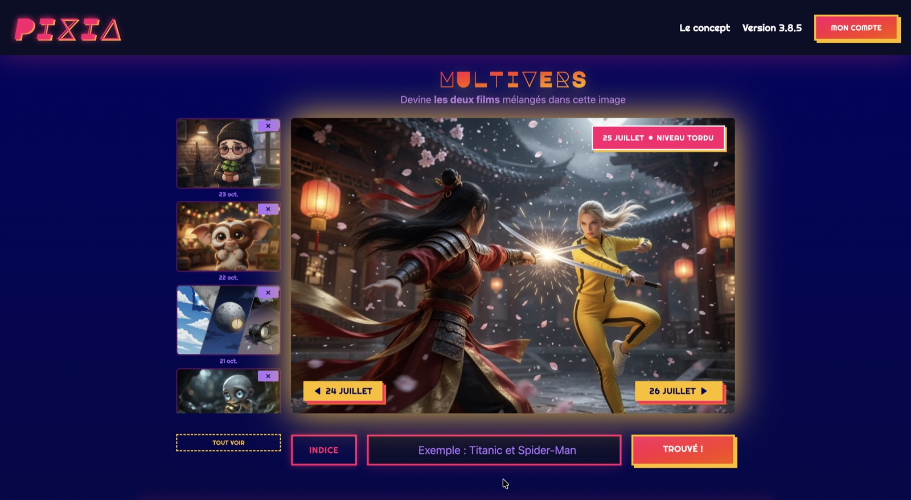
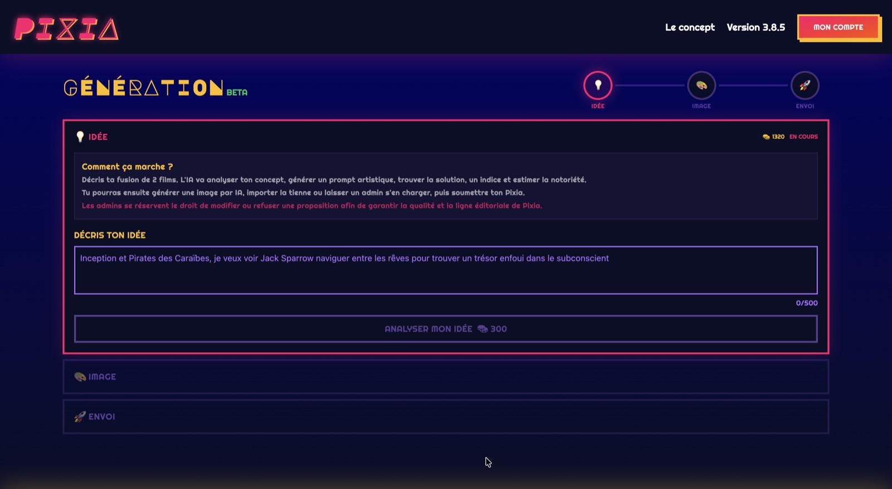

# Pixia

> Chaque jour, une image générée par IA cache **deux films mélangés**. À toi de les retrouver.

## Le concept

Pixia publie **une image par jour**, jouable par tous, connecté ou non. Dans le mode actuel, **Multivers**, l'image fusionne deux films en une seule scène : il faut identifier les deux titres.

- **Tentatives illimitées**, avec une reconnaissance tolérante : accents, ordre des mots, fautes de frappe, titres FR ou EN.
- **Un indice** par partie pour les joueurs connectés, au prix d'environ la moitié des points.
- **Des points selon la difficulté** (de *Simple* à *Impossible*), convertis en jetons.
- **Un classement mensuel**, des badges et des statistiques de jeu.
- **Les joueurs créent aussi des parties** : ils décrivent leur idée, l'IA l'analyse et génère l'image, puis les admins modèrent avant publication.

D'autres modes sont en préparation : Kawaii, Polychrome et Convergence.

## Aperçu

| La partie du jour | Bonne réponse : la solution est révélée |
|---|---|
|  |  |

| Niveau Tordu | Niveau Vicieux |
|---|---|
|  |  |

| Le classement du mois | Les badges |
|---|---|
|  |  |

| Créer une partie avec l'IA | Mes parties générées |
|---|---|
|  |  |

## Architecture

Pixia est découpé en deux dépôts :

| Dépôt | Rôle | Stack |
|---|---|---|
| **[Pixia](https://github.com/ThomasBerranger/Pixia)** (ce dépôt) | Application web | React, TypeScript, Vite |
| **[Pixia-API](https://github.com/ThomasBerranger/Pixia-API)** | API et logique métier | Symfony, MySQL, JWT |

Le front était déployé sur Vercel et l'API sur Railway.

## Stack

- **React 19** et **TypeScript 5** en mode strict : environ 12 000 lignes réparties sur 129 fichiers
- **Vite 7** et **PWA** installable (`vite-plugin-pwa`, Workbox)
- **Tailwind CSS 3**, avec un design system rétro-néon à base de tokens
- **Zustand 5** pour l'état global, **React Router 7** avec lazy loading des routes non critiques
- Connexion par **JWT** ou **Google OAuth**

## Points techniques

**Contrat de version avec l'API.** Chaque requête envoie un header `X-App-Version`. Si l'API juge le front trop ancien, elle répond `426 Upgrade Required` : `useApi` intercepte ce statut et affiche une modale bloquante qui force le rechargement, sans jamais remonter d'erreur parasite à l'appelant. Cela permet de faire évoluer le contrat d'API sans casser les clients installés.

**PWA avec deux niveaux de mise à jour.** Une nouvelle version détectée par le service worker déclenche une bannière non bloquante. Une incompatibilité signalée par l'API déclenche la mise à jour bloquante. Les images sont servies en `CacheFirst` (60 entrées, 30 jours) pour un affichage immédiat.

**Un point d'entrée unique pour l'API.** Tous les appels passent par le hook `useApi`, qui injecte le token et normalise les erreurs en `ApiError` typées. Les endpoints, routes et couleurs sont centralisés en constantes ou en tokens Tailwind, jamais en dur dans le JSX.

**Atomic Design appliqué strictement.** Les `atoms/` n'ont aucune dépendance au métier, aux hooks ni aux stores. La logique vit dans des hooks (`useGameForm`, `useApi`, `useDebounce`…), les utilitaires (`utils/`) sont des fonctions pures, et les pages se limitent à l'orchestration.

**Plusieurs profils dans une seule application.** L'espace joueur (jeu, profil, création de parties assistée par IA), l'espace admin (modération des parties soumises) et l'espace super-admin (utilisateurs, génération de parties, contributions, journal d'activité) sont servis par le même front, derrière un `ProtectedRoute` qui exige le rôle requis.

## Auteur

Projet conçu et développé par [Thomas Berranger](https://github.com/ThomasBerranger) aka Mirage.
