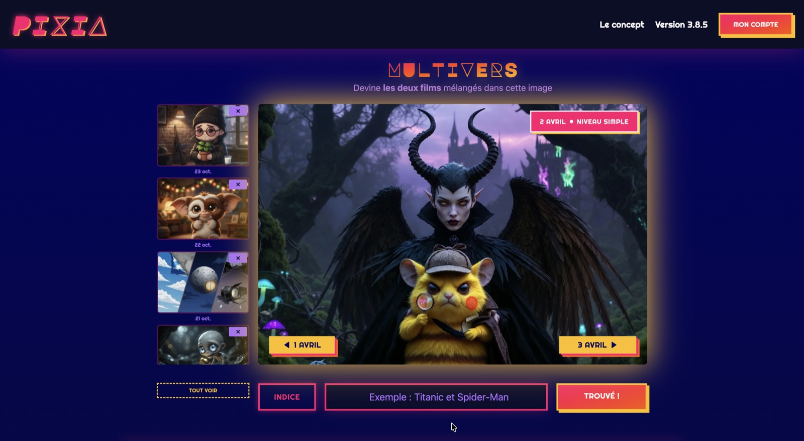
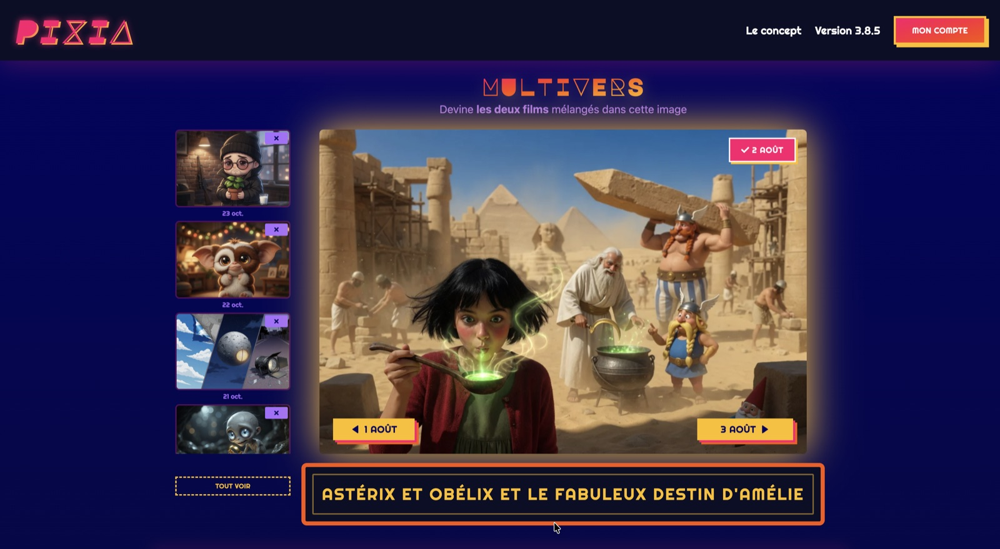
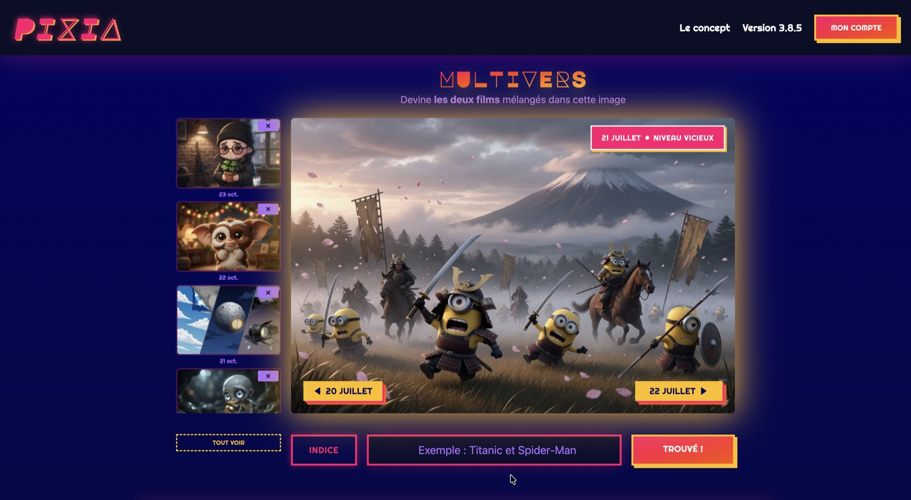
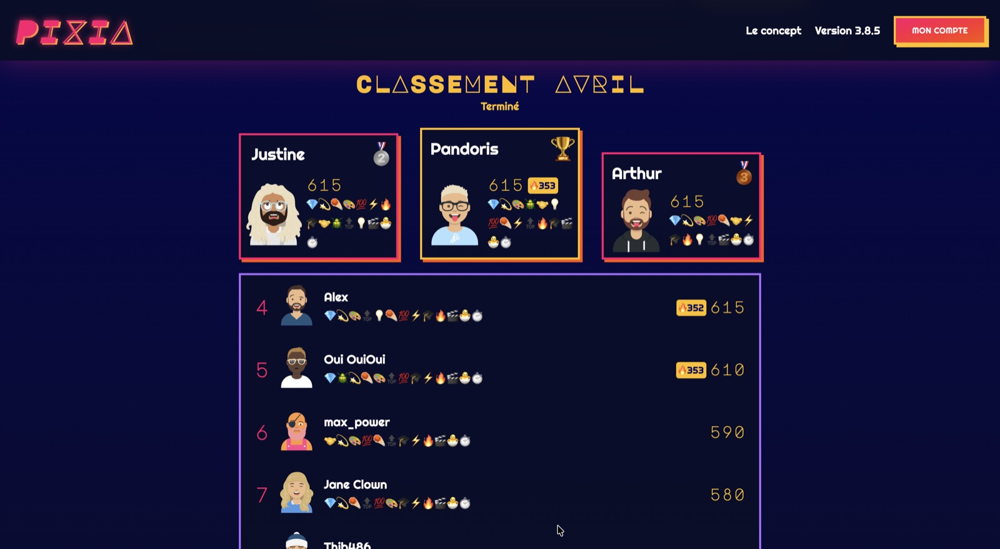
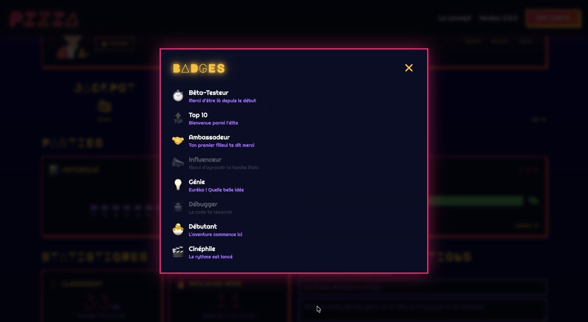

# Pixia

> Chaque jour, une image générée par IA cache **deux films mélangés**. À toi de les retrouver.

> ⚠️ Le site n'est plus en ligne : ce dépôt présente le projet.

## Le concept

Pixia publie **une image par jour**, jouable par tous, connecté ou non. Dans le mode actuel, **Multivers**, l'image fusionne deux films en une seule scène : il faut identifier les deux titres.

- **Tentatives illimitées**, avec une reconnaissance tolérante : accents, ordre des mots, fautes de frappe, titres FR ou EN.
- **Un indice** par partie pour les joueurs connectés, au prix d'environ la moitié des points.
- **Des points selon la difficulté** (de *Simple* à *Impossible*), convertis en jetons.
- **Un classement mensuel**, des badges et des statistiques de jeu.
- **Les joueurs créent aussi des parties** : ils décrivent leur idée, l'IA l'analyse et génère l'image, puis les admins modèrent avant publication.

D'autres modes sont en préparation : Kawaii, Polychrome et Convergence.

## Aperçu

| La partie du jour | Bonne réponse : la solution est révélée |
|---|---|
|  |  |

| Niveau Tordu | Niveau Vicieux |
|---|---|
|  |  |

| Le classement du mois | Les badges |
|---|---|
|  |  |

| Créer une partie avec l'IA | Mes parties générées |
|---|---|
|  |  |

## Architecture

Pixia est découpé en deux dépôts :

| Dépôt | Rôle | Stack |
|---|---|---|
| **[Pixia](https://github.com/ThomasBerranger/Pixia)** (ce dépôt) | Application web | React, TypeScript, Vite |
| **[Pixia-API](https://github.com/ThomasBerranger/Pixia-API)** | API et logique métier | Symfony, MySQL, JWT |

Le front était hébergé sur Vercel et l'API sur Railway. Les images sont générées par IA, et l'analyse des idées par un LLM.

## Stack front

- **React 19** et **TypeScript 5** en mode strict
- **Vite 7**, avec une **PWA** installable (`vite-plugin-pwa`)
- **Tailwind CSS 3**, avec un design system rétro-néon à base de tokens
- **Zustand** pour l'état global, **React Router 7** avec lazy loading
- **Vitest** et Testing Library

Quelques choix d'architecture :

- Les composants suivent un **Atomic Design** strict : les `atoms/` n'ont aucune dépendance au métier, aux hooks ni aux stores.
- Tous les appels API passent par un hook unique, `useApi`, qui gère silencieusement les erreurs communes.
- Les routes, endpoints et couleurs sont centralisés en constantes ou en tokens Tailwind, jamais en dur dans le JSX.

## Auteur

Projet conçu et développé par [Thomas Berranger](https://github.com/ThomasBerranger) aka Mirage.
