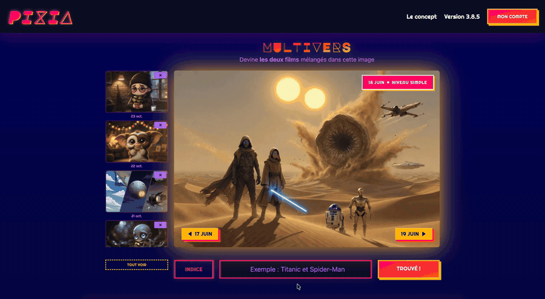
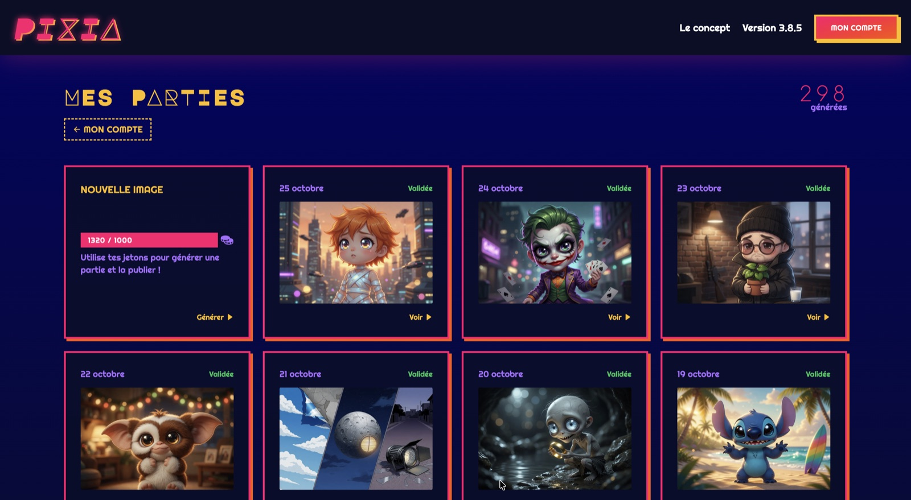

# Pixia

> Chaque jour, une image générée par IA cache un film, un personnage ou deux univers mélangés. À toi de les retrouver.

## Le concept

Pixia publie **une image par jour**, jouable par tous, connecté ou non. Le type de jeu varie d'un jour à l'autre :

| Mode | L'image montre | À deviner |
|---|---|---|
| **Multivers** | deux films fusionnés en une seule scène | les deux films |
| **Kawaii** | un personnage redessiné en version kawaii | le personnage |
| **Polychrome** | un film résumé en illustration minimaliste | le film |
| **Convergence** | plusieurs éléments d'un même film réunis | le film |

- **Tentatives illimitées**, avec une reconnaissance tolérante : accents, ordre des mots, fautes de frappe, titres FR ou EN.
- **Un indice** par partie pour les joueurs connectés, au prix d'environ la moitié des points.
- **Des points selon la difficulté** (de *Simple* à *Impossible*), convertis en jetons.
- **Un classement mensuel**, des badges et des statistiques de jeu.
- **Les joueurs créent aussi des parties Multivers** : ils décrivent leur idée, l'IA l'analyse et génère l'image, puis les admins modèrent avant publication.

## Aperçu

| La partie du jour | Bonne réponse : la solution est révélée |
|---|---|
|  |  |

| Niveau Tordu | Niveau Vicieux |
|---|---|
|  |  |

| Le classement du mois | Les badges |
|---|---|
|  |  |

| Créer une partie avec l'IA | Mes parties générées |
|---|---|
|  |  |

## Architecture

Pixia est découpé en deux dépôts :

| Dépôt | Rôle | Stack |
|---|---|---|
| **[Pixia](https://github.com/ThomasBerranger/Pixia)** (ce dépôt) | Application web | React, TypeScript, Vite |
| **[Pixia-API](https://github.com/ThomasBerranger/Pixia-API)** | API et logique métier | Symfony, MySQL, JWT |

Le front était déployé sur Vercel et l'API sur Railway.

## Stack

- **React 19** et **TypeScript 5** en mode strict : environ 12 000 lignes réparties sur 129 fichiers
- **Vite 7** et **PWA** installable (`vite-plugin-pwa`, Workbox)
- **Tailwind CSS 3**, avec un design system rétro-néon à base de tokens
- **Zustand 5** pour l'état global, **React Router 7** avec lazy loading des routes non critiques
- Connexion par **JWT** ou **Google OAuth**

## Auteur

Projet conçu et développé par [Thomas Berranger](https://github.com/ThomasBerranger) aka Mirage.
